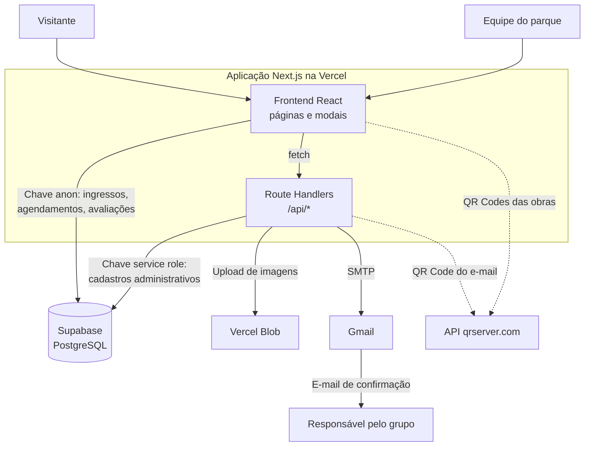
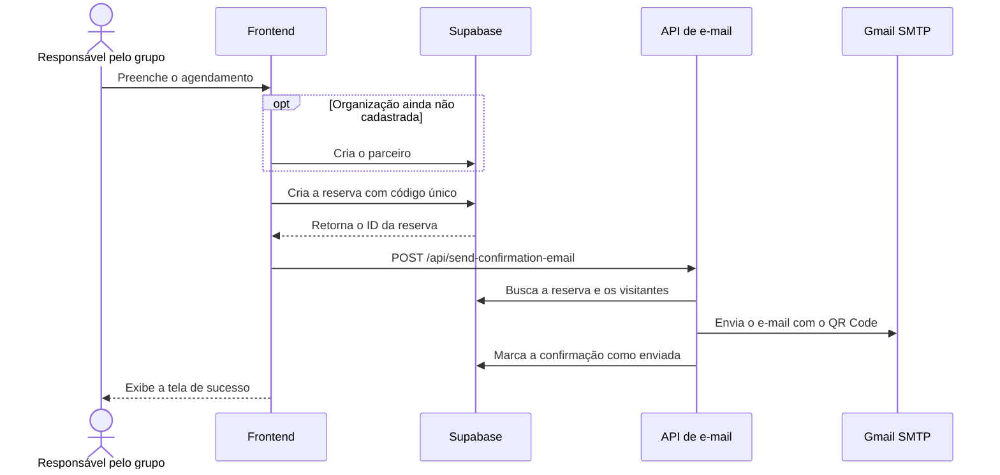

# RecentroConecta

Plataforma web para gestão e visitação do **Parque de Esculturas Francisco Brennand**, no Recife: ingressos digitais com QR Code, agendamento de grupos, conteúdo interativo sobre as obras e painel administrativo.


**[Acessar a aplicação publicada](https://v0-recentro-conecta-prototype.vercel.app/)**

> **Status do projeto:** protótipo funcional (MVP). Os fluxos do visitante e os cadastros administrativos estão integrados ao banco; a validação de entrada e parte dos relatórios ainda são demonstrativos. Os detalhes estão em [Status e limitações](#status-e-limitações).

## Visão Geral

### O que é o RecentroConecta

O RecentroConecta centraliza em uma única aplicação web a experiência de quem visita o parque e a operação de quem o administra. O visitante consulta se o parque está aberto, emite um ingresso gratuito, agenda a visita de um grupo e conhece as esculturas pelo QR Code de cada obra. A equipe gerencia funcionários, parceiros e o acervo em um painel próprio.

### Qual problema resolve

O parque é um museu a céu aberto, com visitação gratuita, e sua operação depende de comunicação informal e gera poucos dados. O projeto substitui esse cenário por um sistema que:

- registra quem visita, de onde vem e como chegou até o parque;
- organiza as visitas de escolas, hotéis, agências e ONGs;
- leva informação sobre cada obra ao celular do visitante;
- cria um canal direto de feedback.

### Quem pode utilizar

| Perfil | Uso |
|---|---|
| **Visitantes** (moradores e turistas) | Consultar o status do parque, emitir ingresso, explorar as obras e avaliar a visita |
| **Organizações parceiras** (escolas, hotéis, agências, ONGs, empresas) | Agendar visitas de grupos e receber a confirmação por e-mail |
| **Equipe do parque** | Administrar cadastros, acervo e status do parque, e consultar relatórios |

O desenho do produto partiu da persona Antônia Gusmão, com prioridade para usabilidade e acessibilidade, e foi conduzido com Scrum em sprints de duas semanas.

### Benefícios

- **Dados para decisão:** o perfil dos visitantes é coletado já na emissão do ingresso.
- **Acesso sem instalação:** funciona no navegador, e o QR Code de cada obra abre direto na câmera do celular.
- **Acessibilidade:** a descrição das obras pode ser ouvida em voz alta, em português.
- **Menos atrito no agendamento:** a confirmação chega por e-mail, com QR Code e código da reserva.

## Funcionalidades

### Área do visitante

- **Status do parque:** combina a configuração do banco com o horário de funcionamento e é atualizado a cada 30 segundos.
- **Ingresso digital individual:** formulário com perfil do visitante, QR Code único e download em PDF.
- **Agendamento de grupos:** seleção de parceiro existente ou cadastro de um novo, com data, horário, quantidade de pessoas e tipo de visita (guiada ou livre).
- **Confirmação por e-mail:** mensagem em HTML com código da reserva e QR Code, enviada via SMTP.
- **Catálogo de esculturas:** listagem das obras com imagem, descrição e curiosidades.
- **Página pública de cada obra:** rota `/escultura/[id]`, aberta pelo QR Code físico.
- **Audiodescrição:** leitura do conteúdo da obra com a Web Speech API, em `pt-BR`.
- **Avaliação da visita:** nota de 1 a 5 estrelas com comentário opcional.
- **Informações práticas:** como chegar, mapa incorporado, regras e história do parque.

### Painel administrativo

- **Login de funcionários** por e-mail e senha.
- **Funcionários:** cadastro com senha temporária, listagem, exclusão e alteração de senha.
- **Parceiros:** cadastro, listagem, edição e exclusão.
- **Esculturas:** cadastro, listagem, edição, exclusão e busca por nome, com upload de imagem.
- **QR Codes das obras:** geração e impressão para instalação nas esculturas.
- **Relatórios em PDF:** inventário do acervo e lista de visitantes validados por data.
- **Dashboard:** gráficos de visitação e satisfação (dados demonstrativos) e feedbacks reais dos visitantes.
- **Controle de funcionamento:** alternância entre parque aberto e fechado.
- **Leitura de ingressos:** leitor de QR Code pela câmera e busca de agendamentos por data.

## Arquitetura da Solução

A aplicação é um monólito em **Next.js (App Router)**: interface e backend ficam no mesmo projeto e são publicados juntos. O acesso a dados segue dois caminhos, conforme a operação.



### Frontend

- **Next.js 14 e React 19**, com componentes de cliente nas telas interativas e renderização no servidor na página pública de cada obra.
- **Tailwind CSS 4 e shadcn/ui** (sobre Radix UI) na interface, com layout responsivo.
- **Recharts** nos gráficos, **jsPDF** nos PDFs, **qrcode.react** nos ingressos e **html5-qrcode** na leitura pela câmera.

### Backend

São 22 Route Handlers em `app/api/`, sem servidor separado:

| Domínio | Rotas | Responsabilidade |
|---|---|---|
| Autenticação | `/api/auth/login` | Verificar as credenciais do funcionário |
| Funcionários | `/api/employees/*` | Criar, listar, excluir e gerenciar senhas |
| Parceiros | `/api/partners/*` | Criar, listar, atualizar e excluir |
| Esculturas | `/api/sculptures/*` | Criar, listar, atualizar, excluir e registrar curtidas |
| Avaliações | `/api/feedbacks/list` | Listar as avaliações dos visitantes |
| Arquivos | `/api/upload` | Enviar imagens ao Vercel Blob |
| E-mail | `/api/send-confirmation-email` | Enviar a confirmação do agendamento |
| Validação | `/api/tickets/validate`, `/api/validar-ingresso`, `/api/validar_ingresso`, `/api/validate-booking` | Validar ingressos e reservas (ainda não usadas pelas telas) |

### Serviços externos

| Serviço | Uso |
|---|---|
| **Supabase** | Banco PostgreSQL com Row Level Security |
| **Vercel** | Hospedagem e métricas (Vercel Analytics) |
| **Vercel Blob** | Armazenamento das imagens das esculturas |
| **Gmail SMTP** (via Nodemailer) | Envio dos e-mails de confirmação |
| **qrserver.com** | Geração de imagens de QR Code para impressão e e-mail |
| **Google Maps** | Mapa incorporado na tela "Como Chegar" |

### Fluxo de dados: agendamento de grupo



### Modelo de dados

| Tabela | Conteúdo | Definida em `scripts/` |
|---|---|---|
| `park_settings` | Status e horário de funcionamento | Sim |
| `sculptures` | Acervo: código, nome, descrição, curiosidade e imagem | Sim |
| `employees` | Funcionários e credenciais | Sim |
| `partners` | Organizações parceiras | Sim |
| `tickets` | Ingressos e perfil dos visitantes | Sim |
| `satisfaction_ratings` | Avaliações dos visitantes | Sim |
| `sculpture_visits` | Visitas por escultura (ainda sem uso no código) | Sim |
| `bookings` | Reservas de grupos | **Não** |
| `booking_visitors` | Visitantes de cada reserva | **Não** |

## Estrutura do Projeto

```text
.
├── app/
│   ├── page.tsx              # Página inicial do visitante
│   ├── admin/                # Painel administrativo
│   ├── api/                  # Route Handlers (backend)
│   ├── escultura/[id]/       # Página pública de cada obra
│   ├── validar/              # Início da validação de ingressos
│   └── validacao/            # Telas de leitura, sucesso e erro
├── components/
│   ├── ui/                   # Componentes base (shadcn/ui)
│   └── *.tsx                 # Modais de ingresso, agendamento, login e avaliação
├── lib/
│   └── supabase.ts           # Cliente Supabase e tipos
├── public/images/            # Logos e fotos do parque
└── scripts/                  # Scripts SQL e teste de CRUD
```

## Como Executar Localmente

### Pré-requisitos

- Node.js 18.17 ou superior (testado com a versão 20.19)
- pnpm (testado com a versão 10.22)
- Um projeto no [Supabase](https://supabase.com)

### 1. Instale as dependências

```bash
git clone https://github.com/leonidasprof/RecentroConecta-n6.git
```

```bash
cd RecentroConecta-n6
```

```bash
pnpm install
```

### 2. Configure as variáveis de ambiente

Crie um arquivo `.env.local` na raiz do projeto:

```env
NEXT_PUBLIC_SUPABASE_URL=https://seu-projeto.supabase.co
NEXT_PUBLIC_SUPABASE_ANON_KEY=sua-chave-anon
SUPABASE_URL=https://seu-projeto.supabase.co
SUPABASE_SERVICE_ROLE_KEY=sua-chave-service-role
GMAIL_USER=seu-email@gmail.com
GMAIL_PASSWORD=sua-senha-de-app
BLOB_READ_WRITE_TOKEN=seu-token-do-vercel-blob
NEXT_PUBLIC_BASE_URL=http://localhost:3000
```

| Variável | Obrigatória | Finalidade |
|---|---|---|
| `NEXT_PUBLIC_SUPABASE_URL` | Sim | URL do projeto no Supabase |
| `NEXT_PUBLIC_SUPABASE_ANON_KEY` | Sim | Chave pública, usada no navegador |
| `SUPABASE_URL` | Sim | URL do Supabase, lida por `/api/feedbacks/list` e `/api/employees/delete` |
| `SUPABASE_SERVICE_ROLE_KEY` | Sim | Chave administrativa, usada apenas no servidor |
| `GMAIL_USER` | Para enviar e-mails | Conta remetente |
| `GMAIL_PASSWORD` | Para enviar e-mails | Senha de app da conta Google |
| `BLOB_READ_WRITE_TOKEN` | Para enviar imagens | Token lido automaticamente pelo SDK do Vercel Blob |
| `NEXT_PUBLIC_BASE_URL` | Não | URL base dos links do e-mail (padrão: `http://localhost:3000`) |

> **Atenção:** o repositório ainda não tem `.gitignore`. Crie um com `.env*`, `node_modules/` e `.next/` antes do primeiro commit para não publicar suas chaves.

### 3. Prepare o banco de dados

Execute os arquivos de `scripts/` no SQL Editor do Supabase, nesta ordem:

1. `001_create_tables.sql`
2. `002_enable_rls.sql`
3. `003_seed_data.sql` (dados de exemplo)
4. `004_add_employee_password.sql`
5. `006_seed_admin_user.sql` (usuário administrador de desenvolvimento)
6. `009_allow_public_partners_read.sql`
7. `add_sculpture_image_column.sql`

O script `005_seed_admin_employee.sql` pode ser ignorado: ele grava um hash bcrypt, e o login atual compara a senha em texto puro.

Os scripts não reproduzem sozinhos o esquema usado pelo código. Para todos os fluxos funcionarem, ajuste também:

- **Tabela `bookings`:** criar com `id`, `booking_code`, `responsible_name`, `responsible_email`, `responsible_phone`, `visit_date`, `visit_time`, `total_visitors`, `visitor_type`, `qr_code`, `confirmation_sent`, `validated`, `validated_at` e `created_at`.
- **Tabela `booking_visitors`:** criar com `id`, `booking_id` (chave estrangeira para `bookings`), `name`, `age`, `document_type` e `document_number`.
- **Tabela `sculptures`:** adicionar `sculpture_number`.
- **Tabela `tickets`:** adicionar `visitor_document_type`, `visitor_document_number` e `validation_history`.
- **Tabela `park_settings`:** o painel atualiza o registro de `id = 1`, enquanto o script cria `id` como UUID.
- **Políticas de RLS:** o script restringe várias operações a usuários `authenticated`, mas a aplicação não usa o Supabase Auth. Revise as permissões de `park_settings`, `tickets`, `partners` e `bookings`, acessadas pelo navegador com a chave anon.

Essas colunas foram levantadas a partir do uso no código.

### 4. Inicie a aplicação

```bash
pnpm dev
```

A aplicação fica disponível em `http://localhost:3000`, e o painel em `/admin`.

### Comandos disponíveis

| Comando | Descrição |
|---|---|
| `pnpm dev` | Inicia o servidor de desenvolvimento |
| `pnpm build` | Gera o build de produção |
| `pnpm start` | Executa o build de produção |
| `npx tsx scripts/test-crud.ts` | Testa o CRUD de funcionários, parceiros e esculturas com o servidor em execução |

O teste de CRUD faz requisições reais às APIs. Use-o apenas com um banco de desenvolvimento.

## Deploy

O projeto está publicado na **Vercel**. Para um novo deploy:

1. Importe o repositório na Vercel; o framework Next.js é detectado automaticamente.
2. Cadastre as variáveis de ambiente da seção anterior, com `NEXT_PUBLIC_BASE_URL` apontando para a URL de produção.
3. Crie um Blob Store no projeto e vincule-o para gerar o `BLOB_READ_WRITE_TOKEN`.
4. Prepare o banco de produção no Supabase, como descrito em [Prepare o banco de dados](#3-prepare-o-banco-de-dados).
5. Publique. Cada push na branch principal gera um novo deploy.

## Status e limitações

Este é um protótipo em evolução, criado inicialmente com o [v0.app](https://v0.app). A lista abaixo mostra o que ainda não reflete o comportamento final.

### Dados e telas demonstrativas

- **Validação de entrada:** a tela `/validacao/scanner` é uma simulação que sempre leva ao sucesso em 3 segundos. As APIs de validação existem, com regras como uso único e validade de 24 horas, mas nenhuma tela as utiliza.
- **Leitor do painel:** a leitura pela câmera procura o `id` do registro, enquanto o QR Code do ingresso contém o `ticket_number`.
- **Dashboard:** os indicadores e gráficos usam valores fixos; apenas os feedbacks vêm do banco.
- **Página inicial:** o contador de visitantes e os horários de maré são simulados, e o botão de idioma ainda não traduz o conteúdo.
- **Leitor de QR Code da página inicial:** ainda não está ativo. Os QR Codes físicos funcionam pela câmera do próprio celular.
- **Exportação na aba Dados:** exibe apenas um aviso, sem gerar arquivo.

### Dados não persistidos

- **Curtidas das obras:** a API responde com sucesso, mas não grava a avaliação.
- **Edição de funcionários:** altera apenas a tela, não o banco.
- **Agendamento:** nome da organização, recursos de acessibilidade e observações não são salvos, e a lista individual de visitantes ainda não é preenchida.
- **Avaliação da visita:** o nome informado pelo visitante não é salvo.

### Segurança

Estes pontos precisam ser resolvidos antes de um uso em produção com dados reais:

- O login não cria sessão no servidor, e a rota `/admin` não exige autenticação.
- As rotas administrativas usam a chave `service_role` sem verificar quem faz a requisição.
- As senhas são armazenadas sem hash, e há uma credencial de demonstração fixa no código.
- Os logs registram dados pessoais e senhas temporárias.
- O build ignora erros de TypeScript e ESLint (`next.config.mjs`).

## Próximos Passos

- [ ] Adotar o Supabase Auth, com sessões e proteção de rotas e APIs
- [ ] Armazenar senhas com hash e remover a credencial fixa
- [ ] Integrar a leitura de QR Code às regras de validação e unificar as rotas duplicadas
- [ ] Criar migrations completas, incluindo `bookings` e `booking_visitors`
- [ ] Alimentar o dashboard e a exportação com dados reais
- [ ] Persistir curtidas, dados de acessibilidade e lista de visitantes
- [ ] Integrar uma fonte real de dados de maré e implementar a tradução para inglês
- [ ] Corrigir os erros de tipagem e adicionar testes automatizados e CI

## Licença

Este repositório ainda não tem uma licença definida.
